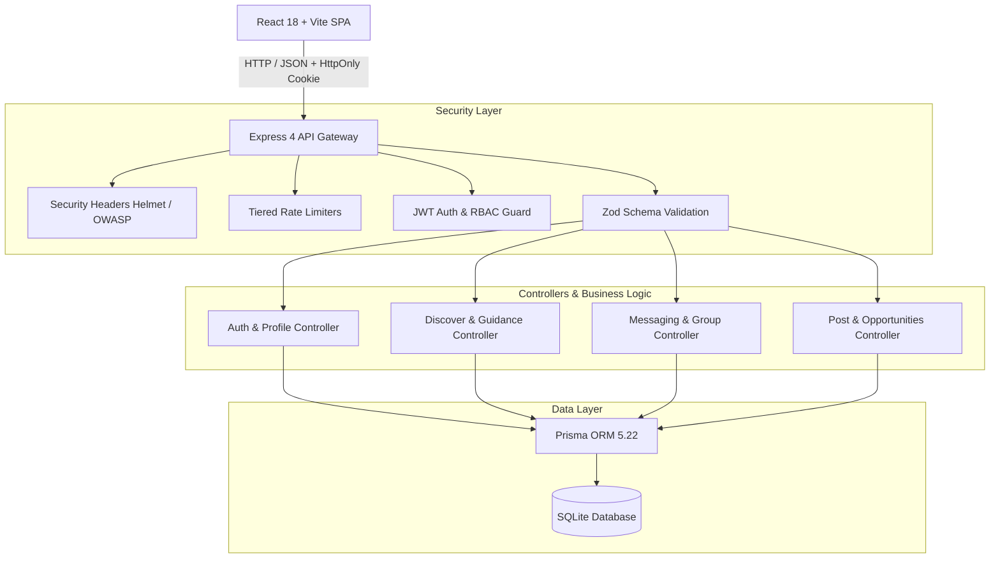

<div align="center">

# 🎓 CampusConnect (C2C)
### *A high-trust, low-pressure campus collaboration and mentorship ecosystem.*

[](https://react.dev/)
[](https://vitejs.dev/)
[](https://nodejs.org/)
[](https://expressjs.com/)
[](https://www.prisma.io/)
[](https://tailwindcss.com/)
[](file:///Users/salonikhandelwal/Desktop/c2c/backend/test_security_audit.js)
[](file:///Users/salonikhandelwal/Desktop/c2c/backend/test_full_user_journey.js)

---

</div>

## 📌 Executive Summary

Modern college campuses are digitally noisy yet socially and academically fragmented. Important research calls and club circulars get buried under thousands of WhatsApp messages; finding hackathon teammates or project collaborators relies on ad-hoc word-of-mouth; and traditional platforms like LinkedIn promote transactional vanity metrics instead of genuine peer connection.

**CampusConnect** solves this by establishing a **high-trust, institution-authenticated digital campus network**. It bridges juniors and seniors, facilitates project teams, and centralizes campus discourse—without follower counts, popularity metrics, or unsolicited spam.

---

## 💡 The Core Philosophy: "Anti-Anxiety Networking"

CampusConnect rejects the psychological traps of standard social networks:

| Traditional Networks | CampusConnect |
|---|---|
| **Vanity Metrics**: Follower counts, clout scores, public likes | **Zero Popularity Scores**: Equal visibility for every student |
| **Transactional Connections**: Cold "Connect" spam | **Contextual "Say Hi"**: Conversation starters based on shared interests |
| **Inbox Flooding**: Relentless unreciprocated DMs | **Single-Message Guard**: Sender is limited to 1 note until recipient replies |
| **Public Leaks**: Contact info exposed by default | **Granular Privacy**: Phone, email & room numbers hidden unless permitted |
| **Open Spam**: Anyone with an email can join | **Campus-Gated**: Strictly restricted to `@mnit.ac.in` credentials |

---

## 🌟 Key Features

### 👤 1. Student Profiles & Portfolio Showcase
- **Dual-Perspective View**: Instant toggle between *My Profile* (with inline editing) and *Peer View* to preview exactly what batchmates see.
- **Academic & Skill Identity**: Showcase batch year, department, hostel, lab group, skills, what you are currently learning, and project repos with live demo links.
- **Strict Privacy Toggles**: Independently toggle visibility for phone number, institutional email, and hostel room number.

### 🔍 2. Discover Peers & Contextual "Say Hi"
- **Multi-Dimensional Discovery**: Filter classmates by batch year, technical skills, interests, "open to" preferences, and hostel.
- **Say Hi Composer**: Start conversations with curated campus icebreakers (*"Chai at Prabha Bhawan?"*, *"Hackathon team?"*) or custom notes.
- **Safety & Anti-Harassment**: Built-in 2-way blocking and reporting. Blocked users cannot message or discover each other.

### 💬 3. Direct Messaging & Group Workspaces
- **1-on-1 Chats**: Real-time polling, message read tracking, and respectful single-message response gates.
- **Sphinx Hackathon Workspaces**: Dedicated team collaboration rooms with member registries, real-time discussions, and project info drawers.
- **Invitation-Only Integrity**: No student is ever added to a group without accepting an explicit invitation.

### 🏛️ 4. Campus Community Commons
- **Categorized Feed**: Filter campus discussions by *Questions*, *Projects*, *College Life*, and *Opportunities*.
- **Developer-Friendly**: Native support for syntax-highlighted code snippets and monospace blocks.
- **Threaded Discourse**: Multi-level nested replies and author-controlled management.
- **Official Highlights**: Separate pinned announcements from student posts with role-gated admin rights.

### 📢 5. Updates & Opportunities Desk
- **Campus Circulars**: Categorized by *Announcements*, *Academic Updates*, *Events*, *Opportunities*, and *Saved*.
- **Admin Verification Badge**: Official department and training & placement notices feature verified institute badging.
- **Calendar Integration**: 1-click `.ics` calendar generation to directly add deadlines to Google Calendar or Apple Calendar.

### 🎓 6. Seniors & Guidance Desk
- **Senior Mentorship Network**: 3rd and 4th-year students can opt in as guidance providers on specific topics (internships, higher studies, competitive programming, open source).
- **Curated FAQ Vault**: Authentic answers to common questions freshmen and sophomores ask.

### 🔎 7. Omni-Search
- Real-time global search across students, community posts, and campus groups simultaneously.

---

## 🏗️ System Architecture



---

## 🛡️ Security & Enterprise Hardening

CampusConnect was subjected to a comprehensive security audit before deployment:

- **Password Security**: Bcrypt with 12 salt rounds; constant-time comparison; password hashes are explicitly excluded from database query projections (`select:` blocks) and never enter memory or response payloads.
- **Cookie & JWT Architecture**: Session tokens are issued in `HttpOnly`, `SameSite=Lax/Strict`, and scoped to `Path=/`. Tokens cannot be read by clientside scripts, mitigating token-theft XSS.
- **OWASP Headers**: Built-in middleware serves `X-Content-Type-Options: nosniff`, `X-Frame-Options: DENY`, `Referrer-Policy: strict-origin-when-cross-origin`, and restricted `Permissions-Policy`.
- **Privilege Escalation Prevention**: Pinned community posts and official opportunity circulars are strictly locked to `admin` roles on the server side.
- **Cross-Account Authorization**: Strict ownership validation (`403 Forbidden`) across profile editing, direct message threads, private groups, post edits, and comment deletions.
- **XSS Sanitization**: URLs (`githubUrl`, `liveUrl`, `linkUrl`) are validated against `javascript:`, `data:`, and `vbscript:` schemes via backend Zod schemas and sanitized on the frontend with `rel="noopener noreferrer"`.
- **Tiered Rate Limiting**:
  - `loginRateLimiter`: 50 attempts / 15 min (brute-force defense)
  - `signupRateLimiter`: 50 signups / 15 min (bot protection)
  - `messageRateLimiter`: 60 msgs / min (inbox flooding defense)
  - `postRateLimiter`: 30 posts or comments / min (anti-spam)
  - `globalApiLimiter`: 500 requests / min per IP

---

## 🧪 Automated Testing & Verification

CampusConnect includes two dedicated test suites validating functionality and security:

```bash
# 1. Run the Full User Journey Checklist (30 Steps)
cd backend && node test_full_user_journey.js

# 2. Run the Comprehensive Security Audit Suite (29 Security Assertions)
cd backend && node test_security_audit.js
```

### Audit Results:
- **User Journey Checklist**: `30/30 PASSED (100%)`
- **Security Assertions**: `29/29 PASSED (100%)`
- **Frontend Production Build**: `0 Errors (Built in 1.41s)`

---

## 🚀 Quickstart Guide

### 1. Prerequisites
- **Node.js**: v18.0.0 or higher
- **npm**: v9.0.0 or higher

### 2. Clone the Repository
```bash
git clone https://github.com/salonikhwal/CampusConnect.git
cd CampusConnect
```

### 3. Install Dependencies
```bash
# Install root dependencies
npm install

# Install backend dependencies
cd backend && npm install

# Install frontend dependencies
cd ../frontend && npm install
cd ..
```

### 4. Configure Environment Variables
Create a `.env` file in the `backend/` directory:
```bash
cp backend/.env.example backend/.env
```

Default configuration in `backend/.env`:
```env
PORT=5001
DATABASE_URL="file:./dev.db"
JWT_SECRET="super_secret_campusconnect_jwt_key_2026"
JWT_EXPIRES_IN="7d"
ALLOWED_EMAIL_DOMAIN="mnit.ac.in"
FRONTEND_URL="http://localhost:5173"
NODE_ENV="development"
```

### 5. Setup the Database
```bash
cd backend
npx prisma db push
node prisma/seed.js
cd ..
```

### 6. Run the Application
You can launch both frontend and backend concurrently from the root directory:
```bash
npm run dev
```

Or run them individually:
```bash
# Terminal 1 - Backend (port 5001)
cd backend && npm run dev

# Terminal 2 - Frontend (port 5173)
cd frontend && npm run dev
```

Visit **`http://localhost:5173`** in your browser!

---

## 📁 Project Directory Structure

```text
CampusConnect/
├── backend/
│   ├── prisma/
│   │   ├── schema.prisma             # Database schema (User, Post, Group, Message, Update, Block)
│   │   └── seed.js                   # Seed dataset (MNIT batchmates, groups, updates)
│   ├── src/
│   │   ├── config/                   # Prisma client & environment configs
│   │   ├── controllers/              # Business logic (Auth, Users, Messages, Groups, Posts, Guidance)
│   │   ├── middleware/               # Auth, Security Headers, Rate Limiters, Zod Validation
│   │   ├── routes/                   # Express REST route endpoints
│   │   ├── schemas/                  # Zod validation schemas with URL sanitizers
│   │   ├── utils/                    # JWT sign/verify, Cookie options
│   │   ├── app.js                    # Express application entrypoint
│   │   └── server.js                 # Server listener
│   ├── test_full_user_journey.js     # 30-step end-to-end user journey test suite
│   └── test_security_audit.js        # 29-step automated security audit test suite
│
├── frontend/
│   ├── public/                       # Static public assets
│   ├── src/
│   │   ├── components/               # Modular UI components (Auth, Profile, Groups, Messages, Commons)
│   │   ├── context/                  # AuthContext for session management
│   │   ├── pages/                    # Home, Discover, Messages, Groups, Commons, Updates, Guidance
│   │   ├── utils/                    # URL sanitizers (anti-XSS) & date formatters
│   │   ├── App.jsx                   # React Router route registry
│   │   ├── index.css                 # Design tokens & custom theme styles
│   │   └── main.jsx                  # Client entrypoint
│   └── tailwind.config.js            # Design tokens & color system
│
├── .gitignore                        # Git ignore rules for node_modules, .env, *.db
├── package.json                      # Monorepo workspace configuration
└── README.md                         # Project documentation
```

## 👥 Hackathon Team & Acknowledgements

Developed with passion for the **MNIT Jaipur Campus Hackathon**.
- **Developer**: Saloni Khandelwal ([@salonikhwal](https://github.com/salonikhwal))
                 Hemlata Chopra([@Hemlata-chopda](https://github.com/Hemlata-chopda))
                 Sankirat Kaur ([@Sankirat-Kaur](https://github.com/Sankirat-Kaur))
- **Institute**: Malaviya National Institute of Technology (MNIT),Jaipur


